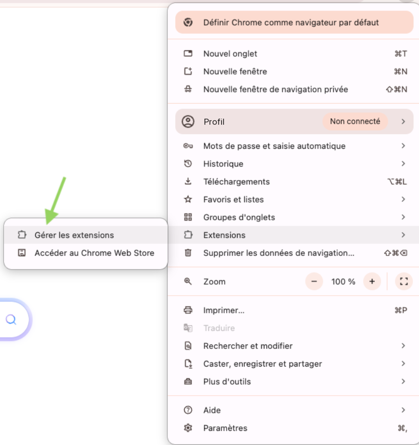
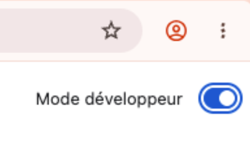
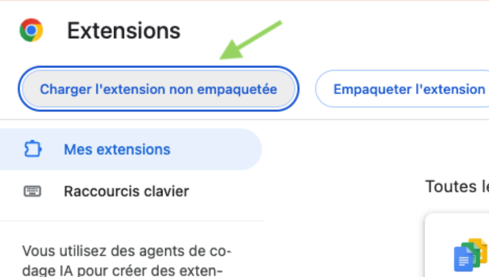
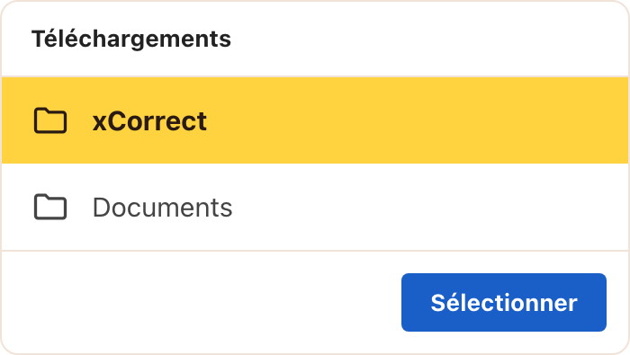
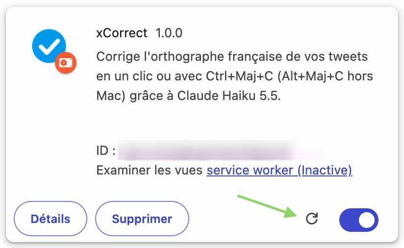

# xCorrect

**xCorrect corrige l'orthographe de vos tweets en français, en un clic, directement dans X.**


- [Installation](#installation)
- [Utilisation](#utilisation)
- [Mise à jour](#mise-à-jour)
- [Télécharger la dernière version](https://github.com/app-buildr/xcorrect/releases/latest/download/xcorrect.zip)

## À quoi ça sert

Vous rédigez un post sur X, vous n'êtes pas sûr d'un accord, d'un accent ou d'une conjugaison. Plutôt que de copier le texte dans un correcteur externe puis de le recoller, vous cliquez sur une icône ajoutée dans la barre d'action du composeur. Quelques secondes plus tard, votre brouillon est remplacé par sa version corrigée, prête à publier.

La correction est confiée à Claude, le modèle d'intelligence artificielle d'Anthropic. Il corrige uniquement les fautes d'orthographe, de grammaire, d'accord, de conjugaison et de ponctuation. Il ne reformule pas, n'allonge pas et ne change ni le sens ni le ton. Les hashtags, mentions, liens, emojis et sauts de ligne sont conservés tels quels.

## Installation

xCorrect ne passe pas par le Chrome Web Store : on le charge en **mode développeur**, une option standard de Chrome. Comptez deux minutes.

### Ce qu'il vous faut

- **Google Chrome**, ou un navigateur compatible avec les extensions Chrome (Brave, Edge, Arc…).
- **Une clé API Anthropic**, à créer sur [console.anthropic.com](https://console.anthropic.com/settings/keys). Le compte doit disposer d'un solde prépayé : quelques dollars suffisent pour des milliers de corrections (voir [Coût](#coût)).

### Étapes

1. **Téléchargez xCorrect**

   [**Télécharger xCorrect (.zip)**](https://github.com/app-buildr/xcorrect/releases/latest/download/xcorrect.zip), puis décompressez l'archive. Rangez le dossier `xCorrect` dans un endroit où il restera, par exemple `Documents` : le navigateur en a besoin en permanence.

2. **Ouvrez la page des extensions**

   Menu **⋮** en haut à droite de Chrome, puis **Extensions** et **Gérer les extensions**.

   

   Plus rapide : tapez `chrome://extensions` dans la barre d'adresse (`brave://extensions` ou `edge://extensions` selon votre navigateur).

3. **Activez le mode développeur**

   L'interrupteur se trouve en haut à droite de la page des extensions.

   

4. **Cliquez sur « Charger l'extension non empaquetée »**

   Le bouton apparaît en haut à gauche dès que le mode développeur est actif.

   

5. **Sélectionnez le dossier `xCorrect`**

   Choisissez le dossier décompressé à l'étape 1, celui qui contient le fichier `manifest.json`, puis validez.

   

6. **Épinglez l'icône**

   Cliquez sur la pièce de puzzle à droite de la barre d'adresse, puis sur l'épingle à côté de xCorrect.

7. **Enregistrez votre clé API**

   Cliquez sur l'icône xCorrect : la page d'options s'ouvre dans un onglet. Collez votre clé API, choisissez votre type de compte X (gratuit ou Premium), puis cliquez sur **Enregistrer**.

**C'est prêt.** Si un onglet X était déjà ouvert, actualisez-le pour que l'icône apparaisse dans le composeur.

## Utilisation

1. **Rédigez votre post** sur X, comme d'habitude : page d'accueil, fenêtre « Poster », réponse ou citation.
2. **Cliquez sur l'icône xCorrect** (un « A » avec une coche) dans la barre d'action sous la zone de texte, à côté des icônes GIF, sondage et emoji. Vous pouvez aussi presser `Ctrl+Maj+C` sur Mac, ou `Alt+Maj+C` sur Windows et Linux.
3. **Patientez une à trois secondes** pendant que l'icône tourne.
4. **Relisez** : le brouillon est remplacé par sa version corrigée et les mots modifiés sont soulignés en vert pendant trois secondes. Si le texte ne contenait aucune faute, rien ne change et l'icône passe simplement au vert.
5. **Publiez** normalement. xCorrect ne publie jamais rien à votre place.

Bon à savoir :

- **Annuler une correction** : `Ctrl+Z` (`Cmd+Z` sur Mac) rétablit votre texte d'origine.
- **Votre mise en forme est préservée** : espaces, sauts de ligne, guillemets, apostrophes, hashtags, mentions, liens et emojis restent tels que vous les avez tapés. Seuls les mots et la ponctuation corrigés changent.
- **Continuez à écrire sans crainte** : si vous modifiez le brouillon pendant la correction, xCorrect ne remplace rien et vous le signale.
- **En cas de problème** (clé manquante ou invalide, solde épuisé, réseau), l'icône passe au rouge et une info-bulle en explique la cause.
- **Changer le raccourci clavier** : rendez-vous sur `chrome://extensions/shortcuts`. La page d'options affiche le raccourci actuellement attribué.
- **Longueur maximale** : 1 000 caractères pour un compte gratuit, 25 000 pour un compte Premium, selon le type choisi dans les options. Le compteur de X reste la référence pour la longueur publiable.

### Dicter un post

Une icône de micro se trouve à côté de l'icône xCorrect, dans les navigateurs capables de reconnaître le français **sur l'appareil** (Google Chrome récent). La reconnaissance tourne localement, avec le modèle embarqué du navigateur : votre voix ne quitte pas votre ordinateur.

1. **Cliquez sur le micro.** La première fois, le navigateur télécharge son modèle de dictée français : l'icône tourne, puis passe au vert. Cliquez à nouveau pour parler.
2. **Autorisez le micro pour x.com** si le navigateur vous le demande (une seule fois). L'autorisation est accordée au site x.com lui-même, pas seulement à xCorrect : voir [Confidentialité](#confidentialité).
3. **Parlez.** Le micro devient rouge et vos mots s'affichent au-dessus, au fil de la dictée.
4. **Arrêtez-vous.** Après deux secondes de silence, ou dès que vous recliquez sur le micro, le texte dicté s'ajoute à la fin du brouillon et la correction démarre d'elle-même.

Bon à savoir :

- La reconnaissance vocale ponctue peu : la correction rétablit ce qu'elle peut, relisez avant de publier.
- `Ctrl+Z` annule d'abord la correction, puis la dictée.
- Sans parole pendant huit secondes, le micro se referme sans rien écrire. Une dictée s'arrête d'elle-même au bout de deux minutes.
- Un saut de ligne tapé juste avant de dicter est respecté : la dictée commence la nouvelle ligne.
- Si le composeur est fermé pendant la dictée, ou si le texte ne peut pas être inséré, il est copié dans le presse-papiers.
- Si l'icône du micro n'apparaît pas, votre navigateur ne sait pas reconnaître le français localement (c'est le cas de Brave). xCorrect ne se rabat jamais sur un service de reconnaissance en ligne.

## Mise à jour

Une extension installée en mode développeur n'est pas mise à jour automatiquement par Chrome. xCorrect vérifie donc lui-même, plusieurs fois par jour, si une nouvelle version est publiée. Quand c'est le cas, un **« ! » rouge** apparaît sur son icône et un **bandeau orange** en haut de la page d'options renvoie vers cette section.

Pas besoin de tout réinstaller : remplacez le dossier, puis rechargez l'extension. Votre clé API et vos réglages sont conservés.

1. **Téléchargez la nouvelle version**

   [**Télécharger xCorrect (.zip)**](https://github.com/app-buildr/xcorrect/releases/latest/download/xcorrect.zip), puis décompressez l'archive.

2. **Remplacez l'ancien dossier `xCorrect`**

   Supprimez l'ancien dossier `xCorrect` et mettez le nouveau à sa place, **au même endroit et sous le même nom**.

   

   C'est important : le navigateur retrouve l'extension, et votre clé API, grâce à l'emplacement du dossier. Chargée depuis un autre dossier, elle serait traitée comme une nouvelle extension.

3. **Ouvrez la page des extensions**

   Menu **⋮** en haut à droite de Chrome, puis **Extensions** et **Gérer les extensions**.

   

   Plus rapide : tapez `chrome://extensions` dans la barre d'adresse (`brave://extensions` ou `edge://extensions` selon votre navigateur).

4. **Rechargez l'extension**

   Cliquez sur la flèche circulaire de la carte xCorrect.

   

   Le numéro de version affiché à côté du nom doit changer, et le « ! » disparaît. Rechargez ensuite vos onglets X.

## Ce que l'extension ne fait pas

- Elle ne publie jamais rien à votre place. Le bouton Poster reste sous votre contrôle.
- Elle n'envoie le texte à l'API Anthropic qu'au moment où vous cliquez sur l'icône ou pressez le raccourci, ou à la fin d'une dictée. Aucun texte n'est lu ni transmis autrement.
- Elle n'écoute le micro que pendant une dictée lancée par un clic, et n'envoie jamais l'audio nulle part.
- Elle ne corrige que le français. Un texte dans une autre langue est renvoyé sans garantie.
- Elle ne vérifie pas la longueur du tweet. Le plafond de caractères porte sur les caractères bruts et garde volontairement de la marge, X comptant une URL pour 23 caractères et un emoji pour 2. Au-delà, la correction est refusée.
- En cas de réponse inattendue du modèle (réponse à une question, traduction, texte vide), le brouillon est laissé intact.

## Coût

Avec Claude Haiku 5.5 (0,10 $ par million de tokens en entrée, 0,50 $ en sortie), une correction de tweet coûte environ 0,0001 $ : quelque 300 tokens en entrée, dominés par le prompt système, et 130 en sortie, réflexion du modèle comprise. Mille corrections coûtent autour de 0,10 $. C'est une estimation tirée d'essais, pas une mesure dans l'extension.

La clé est fournie par chaque utilisateur, qui paie sa propre consommation.

## Confidentialité

- La clé API est stockée dans le navigateur, via `chrome.storage.local`, et n'est lue que par le service worker de l'extension. Elle n'est jamais exposée aux pages web.
- Le texte du brouillon est transmis à l'API Anthropic uniquement lors d'un clic sur l'icône, d'un raccourci ou à la fin d'une dictée. Il est soumis à la politique de conservation des données d'Anthropic.
- La dictée utilise la reconnaissance vocale embarquée du navigateur (Web Speech API, traitement local imposé) : l'audio reste sur l'appareil.
- La dictée s'exécute dans la page de X : l'autorisation du micro que vous donnez est donc enregistrée pour **x.com**, comme celle des fonctions vocales du site. X peut ensuite utiliser le micro sans vous redemander (l'indicateur d'enregistrement de l'onglet reste visible). Pour la retirer : icône à gauche de l'adresse sur x.com, puis **Micro**.
- L'extension ne collecte aucune statistique. En dehors de l'API Anthropic, elle ne contacte que l'API publique de GitHub (`api.github.com`), sans identifiant, pour connaître la dernière version publiée.

## Développement

```bash
npm install
npm run build     # produit dist/, à charger comme extension non empaquetée
npm test
npm run package   # produit xcorrect.zip, à joindre à une release
```

Pour publier une version : augmenter `version` dans `manifest.json` et `package.json`, puis créer une release GitHub au tag `vX.Y.Z` avec `xcorrect.zip` en pièce jointe.

## Avant publication sur le Chrome Web Store

- Une politique de confidentialité est obligatoire : l'extension transmet du contenu rédigé par l'utilisateur à un tiers, l'API Anthropic. L'usage des données doit aussi être déclaré dans la console développeur.
- La permission d'hôte sur `api.anthropic.com` doit être justifiée dans la fiche du store.
- La permission `alarms` sert uniquement à la vérification périodique des mises à jour. Sur le store, Chrome met l'extension à jour lui-même : la détection par GitHub pourra alors être retirée.

## Limites connues

- Les sélecteurs reposent sur les attributs `data-testid` de X. Une refonte de leur interface peut demander une mise à jour de `src/content/selectors.ts`.
- Seuls `x.com`, `twitter.com` et `mobile.twitter.com` sont couverts.
- La correction est prévue pour le français uniquement.
